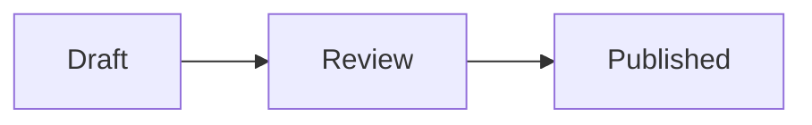

# Discourse Pele

Renders ` ```mermaid ` code blocks in posts and chat messages with
[Pele](https://github.com/obsidianmd/pele) instead of Mermaid.

⚠️ Do not install alongside the Discourse Mermaid component: both render the same
code blocks, and whichever runs first wins.

## Example

````

````

## Updating Pele

Pele is vendored in `assets/` and loaded only on pages with a diagram.

```sh
pnpm update:pele         # latest
pnpm update:pele 1.8.0   # specific version
```

The updater downloads the npm tarball, verifies its integrity hash, extracts
`dist/pele.global.js` to `assets/pele-<version>.global.js`, updates
`about.json`, and removes older bundles.
