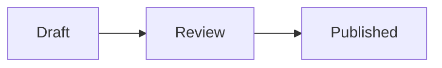

# Discourse Pele

Renders ` ```mermaid ` code blocks in posts and chat messages with
[Pele](https://github.com/obsidianmd/pele) instead of Mermaid.

⚠️ Do not install alongside the Discourse Mermaid component: both render the same
code blocks, and whichever runs first wins.

## Example

````

````
